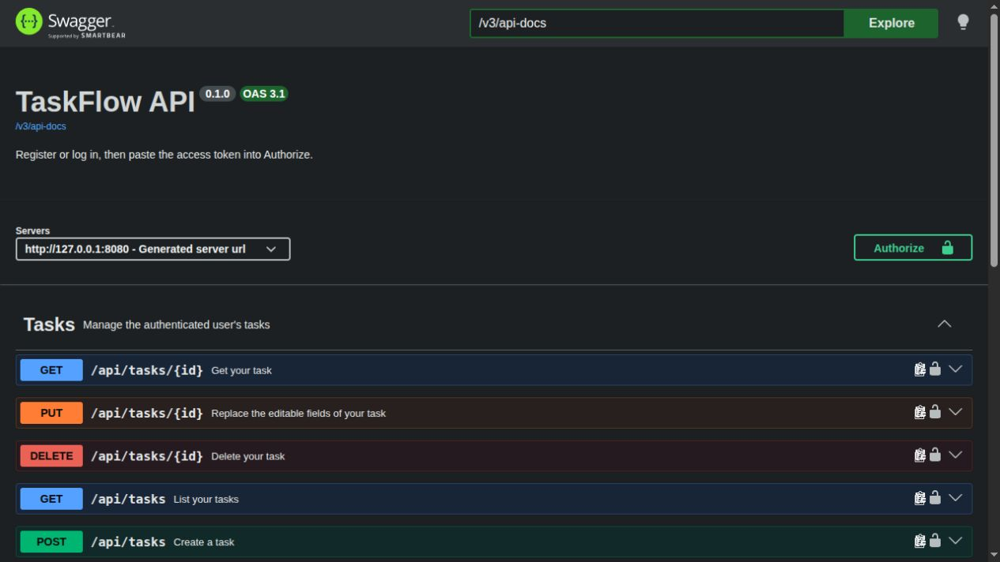
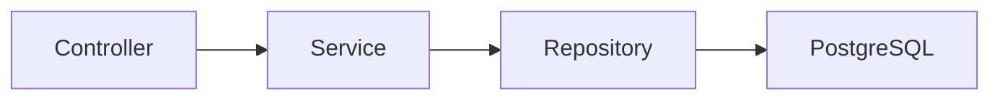

# TaskFlow

A small Java backend for managing personal tasks. It demonstrates a complete REST API, ownership checks, PostgreSQL migrations, and behavior-focused tests.


[Quick start](#quick-start) · [API](#api) · [Tests](#tests) · [Learning guide (RU)](docs/learning-guide.md)

## Features

- Register and log in with a one-hour JWT access token.
- Create, read, replace, and delete your own tasks.
- Filter by status and priority, with stable pagination.
- Explore the API through Swagger UI; no frontend is required.
- Receive consistent JSON errors without SQL, stack traces, or password hashes.



Actual TaskFlow run through Docker Compose at `localhost:8080`, captured on 2026-10-23.

## Stack and compatibility

Java 21, Spring Boot 4.1.2, Spring MVC, Data JPA, Security, Bean Validation, PostgreSQL 18.6, Flyway, and springdoc-openapi 3.1.1. Tests use JUnit Jupiter, Mockito, Spring Boot Test, and Testcontainers PostgreSQL. Maven Wrapper pins Maven 3.9.12; JaCoCo is pinned to 0.8.15. Spring Boot manages the other library and Maven plugin versions.

Versions were checked against the official [Spring Boot requirements](https://docs.spring.io/spring-boot/system-requirements.html), [managed dependencies](https://docs.spring.io/spring-boot/appendix/dependency-versions/coordinates.html), [springdoc compatibility guidance](https://springdoc.org/#what-is-the-compatibility-matrix-of-springdoc-openapi-with-spring-boot), [Flyway PostgreSQL support](https://documentation.red-gate.com/flyway/reference/database-driver-reference/postgresql-database), and [Testcontainers PostgreSQL module](https://java.testcontainers.org/modules/databases/postgres/). Boot 4.1 supports Java 21; springdoc 3.x supports Boot 4.x. PostgreSQL requires Flyway's separate database module, included here.

## Quick start

You need Docker Engine/Desktop with the Docker Compose plugin (`docker compose`). Docker must be running. The first build needs internet access to download dependencies and images. A host JDK or Maven installation is not required for Compose.

From the repository root:

```sh
cp .env.example .env
openssl rand -base64 32
```

Paste the generated single-line value after `JWT_SECRET=` in `.env`. The secret must be Base64 encoding of **at least 32 random bytes**; a readable phrase is not a suitable signing key. The example database password is for a disposable local demo; you can replace it. Do not commit `.env`.

```sh
docker compose up --build
```

After the application logs `Started TaskFlowApplication`, open [Swagger UI](http://localhost:8080/swagger-ui/index.html). The [OpenAPI document](http://localhost:8080/v3/api-docs) is available without a token. Register or log in, copy `accessToken`, click **Authorize**, and paste the token without the `Bearer ` prefix. Swagger adds that prefix.

The app listens on `localhost:8080`; PostgreSQL is exposed on localhost at `DB_PORT` (5432 by default) for local development. Compose waits for PostgreSQL's healthcheck. Flyway creates the schema, and Hibernate validates it. Data survives `docker compose down` in the `postgres_data` named volume. `docker compose down -v` deletes this project's database; use it only when you intend to reset your demo data.

Changing `DB_PASSWORD` does not change a password already stored in an initialized PostgreSQL volume. Keep the original password or deliberately reset the disposable volume. If another database uses port 5432, set `DB_PORT=55432` in `.env`. The app inside Compose still connects to `db:5432`. For host/IDE runs, use the selected host port in `DB_URL`; if port 8080 is occupied, change the app's host-side port in `compose.yaml`.

### Run from an IDE or terminal

Install **JDK 21** and select it as the project SDK/`JAVA_HOME`. The Wrapper downloads Maven. Start only the database:

```sh
docker compose up -d db
```

Spring Boot **does not automatically read `.env`**. Set these variables in your IDE run configuration:

| Variable | Value |
| --- | --- |
| `DB_URL` | `jdbc:postgresql://localhost:5432/taskflow` (replace 5432 with your `DB_PORT`) |
| `DB_USERNAME` | `taskflow` |
| `DB_PASSWORD` | Your `.env` database password |
| `JWT_SECRET` | Your generated Base64 signing key |

For a POSIX terminal, the supplied `.env` format can be loaded explicitly (only source your own trusted file):

```sh
set -a
. ./.env
set +a
export DB_URL="jdbc:postgresql://localhost:${DB_PORT:-5432}/taskflow"
export DB_USERNAME=taskflow
./mvnw spring-boot:run
```

On Windows use `mvnw.cmd` and set the same variables in the IDE or PowerShell environment. Run the app either in Compose or on the host to avoid occupying port 8080 twice.

### Rootless Docker on Linux

Docker's rootless mode runs the daemon as your own user. If it is installed, start it with `systemctl --user start docker` and select `docker context use rootless`. The CLI must be on your `PATH` (a user installation commonly uses `$HOME/.local/bin`). Keep AppArmor enabled; Ubuntu may require the dedicated RootlessKit profile described in the [official rootless instructions](https://docs.docker.com/engine/security/rootless/).

Before running Maven/Testcontainers against that daemon, point it to the rootless socket:

```sh
export DOCKER_HOST="$(docker context inspect rootless --format '{{.Endpoints.docker.Host}}')"
./mvnw clean verify
```

Java 21 is still required on the host. In an IDE, set `JAVA_HOME`/the project SDK and `DOCKER_HOST` in its test environment as well. No Ryuk, container checks, or integration tests need to be disabled.

## Tests

```sh
./mvnw test          # Unit tests; Java 21, no Docker or database needed
./mvnw verify        # Unit + *IT API tests; running Docker required
./mvnw package       # Unit tests and executable target/taskflow-0.1.0.jar
```

Surefire runs unit tests; Failsafe runs `*IT` during `verify`. Integration tests start a fresh PostgreSQL 18.6 container, apply real Flyway migrations, and use real authentication, services, and repositories. No H2 or mocked security is used. Missing Docker makes `verify` fail; integration tests are not silently skipped.

The tests cover registration, duplicate-email handling (including concurrency and the DB constraint), login, validation, malformed/expired/invalidly signed JWTs, CRUD, defaults, filters, pagination, and empty lists. Two-user tests check both response contents and database state: foreign tasks are absent from lists/counts and remain unchanged after denied updates/deletes. Each API test resets its isolated database. Unit tests exercise services and real JWT encoding/validation without starting Spring.

Reports: `target/surefire-reports/`, `target/failsafe-reports/`, and `target/site/jacoco/index.html` after `verify`. For a unit-only coverage report run `./mvnw test jacoco:report`. Coverage reflects the tests actually run; no 100% target is imposed. `./mvnw clean verify` removes coverage from previous runs.

GitHub Actions runs `./mvnw --batch-mode verify` on push and pull request, using Java 21 and the runner's Docker daemon. Test and coverage reports are uploaded even after a failure. The workflow has read-only repository permissions.

No Git remote was configured when this project was created, so there is no build badge yet. After you publish it, open **Actions → CI → Create status badge** in your actual GitHub repository and copy the generated badge here.

## API

All bodies use JSON. `/api/tasks/**` requires `Authorization: Bearer <accessToken>`.

| Method | Endpoint | Success | Purpose |
| --- | --- | --- | --- |
| POST | `/api/auth/register` | 201 | Create an account and return an access token |
| POST | `/api/auth/login` | 200 | Authenticate and return an access token |
| POST | `/api/tasks` | 201 | Create a task; response includes a `Location` header |
| GET | `/api/tasks` | 200 | List your tasks |
| GET | `/api/tasks/{id}` | 200 | Read your task |
| PUT | `/api/tasks/{id}` | 200 | Replace editable fields |
| DELETE | `/api/tasks/{id}` | 204 | Delete your task; empty response body |

Registration requires a valid email (at most 254 characters) and a nonblank password of at least 8 characters and at most 72 UTF-8 bytes. Email is stripped of surrounding whitespace and lowercased with `Locale.ROOT`. The database enforces uniqueness. Login uses the same email normalization and BCrypt byte limit.

### Task fields

| Field | POST | PUT |
| --- | --- | --- |
| `title` | Required, nonblank, at most 120 characters | Required, same validation |
| `description` | Optional, at most 2000 characters | Omitted or `null` clears it |
| `status` | Omitted or `null` → `TODO` | Required: `TODO`, `IN_PROGRESS`, or `DONE` |
| `priority` | Omitted or `null` → `MEDIUM` | Required: `LOW`, `MEDIUM`, or `HIGH` |
| `dueDate` | Optional ISO date `YYYY-MM-DD` | Omitted or `null` clears it |

Past due dates are allowed. `id`, `owner`, `createdAt`, and `updatedAt` are server-controlled and cannot be sent as writable fields. Unknown JSON fields and wrong types are rejected with 400. Timestamps use UTC instants. A no-op PUT may leave `updatedAt` unchanged because no database row change is needed.

List parameters: optional `status` and `priority`; `page` defaults to 0 and must be nonnegative; `size` defaults to 10 and must be 1–50. Enums are case-sensitive. Blank values, invalid enums, nonintegers, and offsets above 2,147,483,647 return 400. Sorting is always `createdAt DESC, id DESC`. The response has `items`, `page`, `size`, `totalElements`, and `totalPages`; counts include only matching tasks owned by the caller. A page beyond the result returns empty `items` with the correct totals.

### Example session

These POSIX examples use `curl` and `jq`. The password is a demo value. Use the returned token and task ID; IDs are not assumed to start at 1.

```sh
BASE=http://localhost:8080
curl --fail-with-body -sS "$BASE/api/auth/register" \
  -H 'Content-Type: application/json' \
  -d '{"email":"student@example.com","password":"LearningJava42!"}' | jq

LOGIN=$(curl --fail-with-body -sS "$BASE/api/auth/login" \
  -H 'Content-Type: application/json' \
  -d '{"email":"student@example.com","password":"LearningJava42!"}')
TOKEN=$(printf '%s' "$LOGIN" | jq -r '.accessToken')

TASK=$(curl --fail-with-body -sS "$BASE/api/tasks" \
  -H "Authorization: Bearer $TOKEN" -H 'Content-Type: application/json' \
  -d '{"title":"Prepare for Java interview","description":"Review transactions"}')
TASK_ID=$(printf '%s' "$TASK" | jq -r '.id')
printf '%s\n' "$TASK" | jq

curl --fail-with-body -sS "$BASE/api/tasks/$TASK_ID" -H "Authorization: Bearer $TOKEN" | jq
curl --fail-with-body -sS "$BASE/api/tasks?status=TODO&priority=MEDIUM&page=0&size=10" \
  -H "Authorization: Bearer $TOKEN" | jq

curl --fail-with-body -sS -X PUT "$BASE/api/tasks/$TASK_ID" \
  -H "Authorization: Bearer $TOKEN" -H 'Content-Type: application/json' \
  -d '{"title":"Prepare for Java interview","status":"DONE","priority":"HIGH"}' | jq

curl --fail-with-body -i -X DELETE "$BASE/api/tasks/$TASK_ID" -H "Authorization: Bearer $TOKEN"
```

You can also use [requests.http](requests.http). Copy tokens and IDs from your responses into its local variables; never commit real tokens. See the [manual checklist](docs/manual-testing.md) for a two-user demonstration.

### Errors

```json
{
  "status": 400,
  "message": "Validation failed",
  "path": "/api/tasks",
  "fieldErrors": {"title": "must not be blank"}
}
```

`fieldErrors` is empty for non-field errors. Common responses: 400 invalid input, 401 missing/invalid/expired token or wrong credentials, 404 missing **or foreign** task, and 409 duplicate email. Unexpected failures return a generic 500.

## Architecture and security



There is one application and one Maven module. Packages are `auth`, `task`, `config`, and `common.error`. Controllers validate DTOs; services implement business rules inside transactions; repositories execute owner-scoped queries. Responses are mapped manually and never serialize JPA entities. Flyway owns the schema; Hibernate uses `ddl-auto=validate` and open-in-view is disabled.

Passwords are stored as BCrypt hashes. Nimbus, through Spring Security, signs and validates HS256 JWTs. Tokens contain the user ID as `sub`, issuer `taskflow`, issue time, and expiry; they last one hour. The decoder verifies the signature, issuer, mandatory expiration, `nbf` when present, and positive numeric user ID. Expiration has zero clock skew, so keep the host clock accurate. The signing secret is supplied through the environment and rejected at startup if malformed or too short.

Authentication is stateless, with Bearer headers only: no login session, HTTP Basic, form login, or authentication cookies. CSRF is disabled because browsers do not automatically attach these credentials. Default security headers remain enabled; CORS is not opened to arbitrary origins. Every task read/update/delete selects by both task ID and user ID; list queries and counts use the same ownership restriction. Swagger documentation is public for local demonstration.

## Design decisions

- **A monolith:** one small domain needs one easy-to-run application.
- **No speculative abstractions:** concrete services and direct mappings keep the request path easy to follow.
- **DTOs:** validation and API fields stay separate from persistence; clients cannot set ownership or see password hashes.
- **PostgreSQL in integration tests:** real SQL constraints, migrations, and query behavior are part of correctness.
- **JWT without refresh tokens:** a smaller authentication flow to study. Users log in again after expiration; token revocation and rotation are outside this version.

## Scope and next steps

This is a learning project, not a production-ready service. It has no rate limiting, refresh/revocation flow, email verification, password recovery, TLS termination, admin roles, or multi-device logout. Duplicate registration intentionally reveals that an email exists through 409. Pagination uses offsets; concurrent inserts can shift page boundaries. Docker Compose, persistence across container recreation, and all 97 Maven tests passed locally; see [local verification notes](docs/verification.md). The GitHub Actions workflow still needs its first run after publishing the repository.

Roadmap ideas: refresh tokens, reminders, and a frontend. They are **not implemented**. The [Russian learning guide](docs/learning-guide.md) includes three smaller exercises you can implement yourself first.

Built as a learning project with AI-assisted development.
