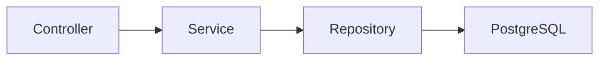

# TaskFlow

A Java REST API for personal tasks, with JWT authentication, owner-scoped access, and PostgreSQL. One Spring Boot application, two entities, and a request path that is easy to follow.


[](https://github.com/adilzhandev/taskflow/actions/workflows/ci.yml)

[Quick start](#quick-start) · [Tests](#tests) · [API](#api) · [Design decisions](#design-decisions) · [Learning guide (RU)](docs/learning-guide.md)

- Register and log in with a one-hour access token.
- Create, read, replace, and delete your own tasks.
- Filter by status and priority, with pagination and stable ordering.
- Explore all seven operations through Swagger UI; no frontend is required.

## Quick start

**Requires:** Git, OpenSSL for key generation, running Docker Engine/Desktop with the Compose plugin (`docker compose`), and internet access for the first build. A host JDK or Maven installation is not needed.

Clone the repository and prepare the environment:

```sh
git clone https://github.com/adilzhandev/taskflow.git
cd taskflow
cp .env.example .env
openssl rand -base64 32
```

Paste the generated single-line value after `JWT_SECRET=` in `.env`, then start the application:

```sh
docker compose up --build
```

After the logs show `Started TaskFlowApplication`, open **[Swagger UI](http://localhost:8080/swagger-ui/index.html)**. Register or log in, copy `accessToken`, and paste it into **Authorize** without the `Bearer ` prefix. Swagger adds the prefix. The [OpenAPI document](http://localhost:8080/v3/api-docs) is also public.

The JWT key must encode **at least 32 random bytes** in Base64. Do not use a readable phrase or commit `.env`. The example database password is intended for a disposable local demo.

<details>
<summary>See the running Swagger UI</summary>


Actual Docker Compose run at `localhost:8080`, captured on 2026-10-23.

</details>

<details>
<summary>Ports, persistent data, and stopping the application</summary>

The app binds to `localhost:8080`. PostgreSQL binds to localhost at `DB_PORT` (5432 by default). If that port is occupied, set `DB_PORT=55432` in `.env`; the app inside Compose still uses `db:5432`. Change the app's host-side port in `compose.yaml` if 8080 is occupied.

Compose waits for PostgreSQL's healthcheck. Flyway creates the schema, and Hibernate validates it. `docker compose down` stops the services while retaining data in the `postgres_data` named volume. **`docker compose down -v` deletes the database**; use it only for an intentional reset.

Changing `DB_PASSWORD` in `.env` does not change the password in an initialized PostgreSQL volume. Keep the original password or deliberately reset a disposable volume.

</details>

## Tests

**Last recorded local verification — 2026-10-23:** `./mvnw clean verify` passed **44 unit tests and 53 integration tests**, with zero failures, errors, or skips. Docker Compose startup, persistence across container recreation, and a two-user API scenario were also verified. See the [verification record](docs/verification.md) for commands, environment details, and results.

```sh
./mvnw test          # Java 21; unit tests, no Docker or database needed
./mvnw verify        # Unit tests + PostgreSQL integration tests; Docker required
./mvnw package       # Unit tests + executable target/taskflow-0.1.0.jar
```

Surefire runs unit tests; Failsafe runs `*IT` during `verify`. API tests start PostgreSQL 18.6 through Testcontainers and exercise real migrations, authentication, services, and repositories. Each API test resets its isolated database. Missing Docker makes `verify` fail; tests are not silently skipped. [Rootless Docker setup](#rootless-docker-on-linux) is documented below.

Tests cover registration and duplicate-email races, login, invalid and expired JWTs, validation, CRUD, defaults, filters, pagination, and empty lists. The two-user tests check database state as well as responses: foreign tasks stay out of lists and counts, and remain unchanged after denied updates or deletes.

Reports are written to `target/surefire-reports/`, `target/failsafe-reports/`, and `target/site/jacoco/index.html` after `verify`. Use `./mvnw test jacoco:report` for a unit-only report, or `./mvnw clean verify` to discard coverage from previous runs. No artificial coverage target is imposed.

[GitHub Actions](https://github.com/adilzhandev/taskflow/actions/workflows/ci.yml) runs two jobs on push and pull request: Java 21 executes `./mvnw --batch-mode verify` and uploads test/coverage reports even after a test failure; a second job builds and starts Docker Compose, then runs HTTP smoke checks. Repository permissions are read-only. The live badge shows the actual workflow status; the dated results above record local verification.

## API

Request bodies use JSON. Every `/api/tasks/**` request requires `Authorization: Bearer <accessToken>`.

| Method | Endpoint | Success | Purpose |
| --- | --- | --- | --- |
| POST | `/api/auth/register` | 201 | Create an account and issue an access token |
| POST | `/api/auth/login` | 200 | Authenticate and issue an access token |
| POST | `/api/tasks` | 201 | Create a task; includes a `Location` header |
| GET | `/api/tasks` | 200 | List your tasks |
| GET | `/api/tasks/{id}` | 200 | Read your task |
| PUT | `/api/tasks/{id}` | 200 | Replace editable fields |
| DELETE | `/api/tasks/{id}` | 204 | Delete your task; empty response body |

Registration requires a valid email of at most 254 characters and a nonblank password of at least 8 characters and at most 72 UTF-8 bytes. Email is stripped of surrounding whitespace and lowercased with `Locale.ROOT`; a database constraint enforces uniqueness. Login uses the same normalization and BCrypt byte limit.

### Task contract

| Field | POST | PUT |
| --- | --- | --- |
| `title` | Required, nonblank, at most 120 characters | Required, same validation |
| `description` | Optional, at most 2000 characters | Same length limit; omitted or `null` clears it |
| `status` | Omitted or `null` → `TODO` | Required: `TODO`, `IN_PROGRESS`, or `DONE` |
| `priority` | Omitted or `null` → `MEDIUM` | Required: `LOW`, `MEDIUM`, or `HIGH` |
| `dueDate` | Optional ISO date `YYYY-MM-DD`; past dates allowed | Omitted or `null` clears it |

`PUT` replaces every editable field. IDs, ownership, and UTC timestamps are server-controlled. Unknown JSON fields and wrong types return 400. A no-op update may leave `updatedAt` unchanged because no database row change is needed.

For the list, `status` and `priority` are optional and case-sensitive. `page` defaults to 0 and must be nonnegative; `size` defaults to 10 and accepts 1–50. Blank values, invalid enums, nonintegers, and offsets (`page × size`) above 2,147,483,647 return 400. Results always use `createdAt DESC, id DESC`.

The response contains `items`, `page`, `size`, `totalElements`, and `totalPages`. Both items and counts include only the caller's matching tasks. A page beyond the result has empty `items` with the correct totals.

<details>
<summary>Try a complete curl session: register → log in → create → read → update → delete</summary>

These POSIX examples require `curl` and `jq`. The password is a demo value; use a fresh email when repeating registration. Tokens and task IDs come from responses.

```sh
BASE=http://localhost:8080
curl --fail-with-body -sS "$BASE/api/auth/register" \
  -H 'Content-Type: application/json' \
  -d '{"email":"student@example.com","password":"LearningJava42!"}' | jq

LOGIN=$(curl --fail-with-body -sS "$BASE/api/auth/login" \
  -H 'Content-Type: application/json' \
  -d '{"email":"student@example.com","password":"LearningJava42!"}')
TOKEN=$(printf '%s' "$LOGIN" | jq -r '.accessToken')

TASK=$(curl --fail-with-body -sS "$BASE/api/tasks" \
  -H "Authorization: Bearer $TOKEN" -H 'Content-Type: application/json' \
  -d '{"title":"Prepare for Java interview","description":"Review transactions"}')
TASK_ID=$(printf '%s' "$TASK" | jq -r '.id')
printf '%s\n' "$TASK" | jq

curl --fail-with-body -sS "$BASE/api/tasks/$TASK_ID" -H "Authorization: Bearer $TOKEN" | jq
curl --fail-with-body -sS "$BASE/api/tasks?status=TODO&priority=MEDIUM&page=0&size=10" \
  -H "Authorization: Bearer $TOKEN" | jq

curl --fail-with-body -sS -X PUT "$BASE/api/tasks/$TASK_ID" \
  -H "Authorization: Bearer $TOKEN" -H 'Content-Type: application/json' \
  -d '{"title":"Prepare for Java interview","status":"DONE","priority":"HIGH"}' | jq

curl --fail-with-body -i -X DELETE "$BASE/api/tasks/$TASK_ID" -H "Authorization: Bearer $TOKEN"
```

The `PUT` above clears the omitted description and due date. For reusable requests, use [requests.http](requests.http) and copy response values into its local variables. Never commit real tokens. The [manual checklist](docs/manual-testing.md) includes a two-user demonstration.

</details>

### Errors

```json
{
  "status": 400,
  "message": "Validation failed",
  "path": "/api/tasks",
  "fieldErrors": {"title": "must not be blank"}
}
```

`fieldErrors` is empty for non-field errors. Statuses are 400 for invalid input, 401 for missing/invalid/expired tokens or wrong credentials, 404 for a missing **or foreign** task, and 409 for a duplicate email. Unexpected failures return a generic 500. Responses do not expose SQL, stack traces, or password hashes.

## Architecture and security



One Maven module contains `auth`, `task`, `config`, and `common.error`. Controllers validate DTOs, services apply business rules inside transactions, and repositories execute owner-scoped queries. Entity-to-DTO mapping is explicit. Flyway owns the schema; Hibernate uses `ddl-auto=validate`, with open-in-view disabled.

Passwords use BCrypt. Spring Security and Nimbus sign and validate HS256 JWTs containing the user ID (`sub`), issuer `taskflow`, issue time, and one-hour expiry. The decoder checks the signature, issuer, mandatory expiration, optional `nbf`, and positive numeric user ID. Expiration uses zero clock skew, so keep the host clock accurate. A malformed or short environment signing key prevents startup.

Authentication is stateless and uses Bearer headers, without login sessions or authentication cookies. CSRF is disabled because browsers do not automatically attach these credentials; HTTP Basic and form login are disabled. Default security headers remain enabled, and CORS is not opened to arbitrary origins. Every task read, update, or delete selects by **both task ID and user ID**; list queries and counts apply the same ownership restriction.

## Design decisions

- **One monolith:** a small domain fits one easy-to-run application.
- **Concrete services and manual mapping:** no speculative interfaces, generic base classes, or mapping framework to obscure the request path.
- **DTOs:** API fields and validation stay separate from persistence, ownership, and password hashes.
- **PostgreSQL in integration tests:** migrations, constraints, and actual SQL behavior are part of correctness.
- **JWT without refresh tokens:** a smaller authentication flow to study. Users log in again after expiration; token revocation and rotation are outside this version.

## Development setup

<details>
<summary>Run from an IDE or terminal with Java 21</summary>

Select JDK 21 as the project SDK/`JAVA_HOME`. On Linux/macOS, install `unzip` so the Maven Wrapper uses the ZIP archive matching its pinned checksum. Prepare `.env` as in Quick start, then run `docker compose up -d db`. The Maven Wrapper downloads Maven. The Docker build image already includes `unzip`.

Spring Boot **does not automatically read `.env`**. Set these variables in the IDE run configuration:

| Variable | Value |
| --- | --- |
| `DB_URL` | `jdbc:postgresql://localhost:5432/taskflow` (replace 5432 with your `DB_PORT`) |
| `DB_USERNAME` | `taskflow` |
| `DB_PASSWORD` | Your `.env` database password |
| `JWT_SECRET` | Your generated Base64 signing key |

For a POSIX terminal, load your own trusted `.env` explicitly:

```sh
set -a
. ./.env
set +a
export DB_URL="jdbc:postgresql://localhost:${DB_PORT:-5432}/taskflow"
export DB_USERNAME=taskflow
./mvnw spring-boot:run
```

On Windows use `mvnw.cmd` and set the same variables in the IDE or PowerShell. Run the app either in Compose or on the host to avoid occupying port 8080 twice.

</details>

<details>
<summary>Use a rootless Docker daemon on Linux</summary>

### Rootless Docker on Linux

If rootless Docker is installed, start it with `systemctl --user start docker` and select `docker context use rootless`. The CLI must be on `PATH` (a user installation commonly uses `$HOME/.local/bin`). Keep AppArmor enabled; Ubuntu may require the dedicated RootlessKit profile in the [official rootless instructions](https://docs.docker.com/engine/security/rootless/).

Point Maven/Testcontainers to that daemon's socket:

```sh
export DOCKER_HOST="$(docker context inspect rootless --format '{{.Endpoints.docker.Host}}')"
./mvnw clean verify
```

The host still needs Java 21. In an IDE, configure the project SDK and `DOCKER_HOST` for tests. Ryuk, container checks, and integration tests remain enabled.

</details>

### Stack and compatibility

Java 21 · Spring Boot 4.1.2 · Spring MVC · Data JPA · Security · Bean Validation · PostgreSQL 18.6 · Flyway · springdoc-openapi 3.1.1. Testing uses JUnit Jupiter, Mockito, Spring Boot Test, and Testcontainers. Maven Wrapper pins Maven 3.9.12 with SHA-256 verification; JaCoCo is pinned to 0.8.15. Spring Boot manages the other library and Maven plugin versions.

<details>
<summary>Official version compatibility references</summary>

Versions were checked against [Spring Boot requirements](https://docs.spring.io/spring-boot/system-requirements.html), [managed dependencies](https://docs.spring.io/spring-boot/appendix/dependency-versions/coordinates.html), [springdoc compatibility guidance](https://springdoc.org/#what-is-the-compatibility-matrix-of-springdoc-openapi-with-spring-boot), [Flyway PostgreSQL support](https://documentation.red-gate.com/flyway/reference/database-driver-reference/postgresql-database), and the [Testcontainers PostgreSQL module](https://java.testcontainers.org/modules/databases/postgres/).

Boot 4.1 supports Java 21, and springdoc 3.x supports Boot 4.x. PostgreSQL requires Flyway's separate database module, included here.

</details>

## Learning and scope

Start with the [Russian learning guide](docs/learning-guide.md), which traces a request through the code and offers three small exercises. Use the [manual checklist](docs/manual-testing.md) for an interactive demonstration and the [verification record](docs/verification.md) for results actually observed.

This is a learning project, not a production-ready service. It has no rate limiting, refresh/revocation flow, email verification, password recovery, TLS termination, admin roles, or multi-device logout. A duplicate registration intentionally reveals that the email exists through 409. Offset pagination can shift page boundaries when tasks are inserted concurrently.

Roadmap ideas: refresh tokens, reminders, and a frontend. These are **not implemented**.

Built as a learning project with AI-assisted development.
